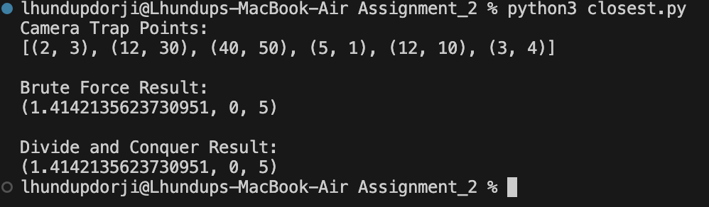
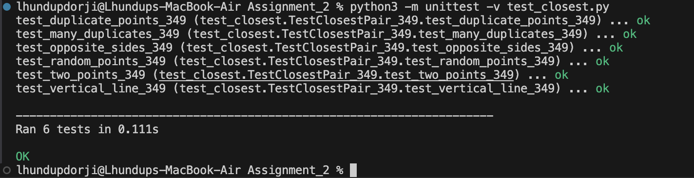

# CSF302 Assignment 2 – Closest Camera Traps

## Description

This project implements two algorithms for finding the closest pair of points:

1. Brute Force
2. Divide and Conquer

## Project Files

| File | Description |
|---|---|
| closest.py | Contains both algorithms |
| test_closest.py | Contains the test cases |
| benchmark.py | Measures execution time |
| benchmark_results.csv | Contains benchmark results |
| closest_pair_graph.png | Log-log graph |
| Assignment2_Report.md | Assignment report |

## Screenshots

### Part A – Program Output



### Part B – Testing



### Part C – Benchmarking


## How to Run

Run the main program:

```bash
python3 closest.py
```

Run the tests:

```bash
python3 -m unittest -v test_closest.py
```

Run the benchmark:

```bash
python3 benchmark.py
```

## Student Information

**Name:** Lhundup Dorji

**Student Number:** 0224349

**Module:** CSF302